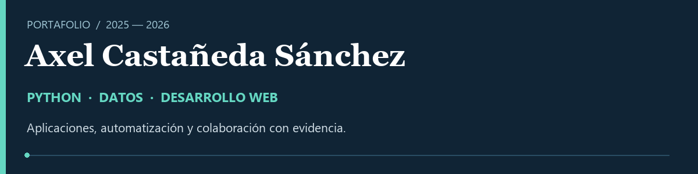
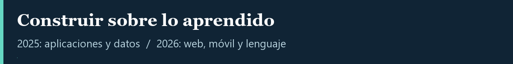
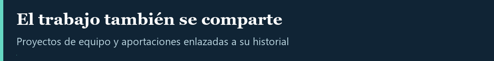
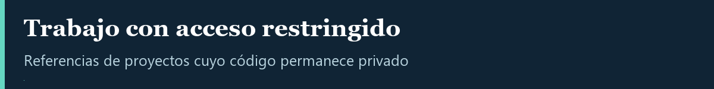
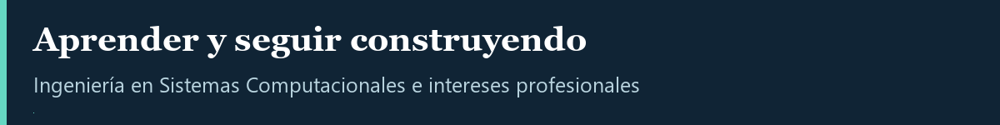

# Axel Castañeda Sánchez

**Desarrollo web · Python · MySQL · Automatización**

Soluciones para procesos de negocio, validación de datos y generación de documentos.

[Portafolio interactivo](https://axelcastasan.github.io/axelcastasan/) · [Proyectos y colaboraciones](#proyectos-y-colaboraciones) · [Experiencia 2026](docs/experiencia-2026.md) · [Evidencia de contribuciones](docs/colaboraciones.md)

---

<h2>Sobre mí</h2>

Soy estudiante de Ingeniería en Sistemas Computacionales en la Universidad del Valle de México, con egreso previsto en **febrero de 2027**. Durante mis prácticas profesionales he desarrollado funcionalidades web con Python y MySQL sobre un sistema existente, con instrucciones y revisión funcional del supervisor.

Utilizo IA generativa como apoyo a la programación, el diseño de interfaces y la documentación técnica. Me interesa seguir desarrollándome en automatización e IA aplicada.

<h2>Trayectoria · 2025–2026</h2>

| Año | Enfoque | Hito |
| --- | --- | --- |
| **2026** | Web, móvil y procesamiento de lenguaje | Prácticas en MIISA y contribuciones públicas a App-SPM, Eje_EGEL y un proyecto de análisis de sentimientos. |
| **2025** | Aplicaciones web y bases de datos | Colaboraciones en Encuesta-docente y AbarrotesUVM. Reconocimiento académico: **9,93/10** en séptimo semestre. |

<h2>Proyectos y colaboraciones</h2>

Proyectos académicos de equipo. Los resúmenes distinguen el objetivo del proyecto de mis aportaciones registradas en Git.

| Proyecto | Qué se hizo | Mi aportación |
| --- | --- | --- |
| **[Análisis de sentimientos](https://github.com/Roroma24/Proyecto-integrador-etapa-3-ISBC)** · 2026 | Aplicación Flask para analizar reseñas con procesamiento de lenguaje natural. | Limpieza de texto, corrección ortográfica, lematización, traducción y ajuste del clasificador con balanceo de clases. |
| **[App-SPM](https://github.com/Roroma24/App-SPM)** · 2026 | Aplicación móvil universitaria con Flutter y backend Flask. | Muro de expresión, perfil, notificaciones y corrección de la integración del proveedor de usuario. |
| **[Simulador EGEL](https://github.com/SVillaluz/Eje_EGEL)** · 2026 | Plataforma de práctica con preguntas y retroalimentación. | Validación de respuestas, alertas visuales, retroalimentación y organización de preguntas con opciones aleatorias. |
| **[Encuesta docente](https://github.com/Roroma24/Encuesta-docente)** · 2025 | Sistema web de evaluación docente y de servicios escolares. | Rutas y filtros de evaluación, interfaces, relaciones y lógica SQL, reportes administrativos y documentación. |
| **[AbarrotesUVM](https://github.com/Roroma24/AbarrotesUVM)** · 2025 | Prototipo de catálogo y carrito con FastAPI y MySQL. | Incorporación del backend: modelos, esquemas, operaciones de catálogo, autenticación y carrito; estructura SQL e interfaz de demostración. |

[Ver commits y alcance de cada colaboración](docs/colaboraciones.md)

Trabajo en repositorios privados

- **[listassist](https://github.com/axelcastasan/listassist)**: proyecto propio de asistencia para un grupo scout, con foco en el pase de lista.
- **[Ejercicio-WSDL](https://github.com/Roroma24/Ejercicio-WSDL)**: colaboración académica; los detalles de implementación permanecen en el repositorio privado.

Estos enlaces requieren autorización del propietario. No se publican código ni datos de esos repositorios en este perfil.

<h2>Experiencia destacada · 2026</h2>

| Desarrollo web | Bases de datos | Automatización |
| --- | --- | --- |
| **13** rutas y puntos finales de API desarrollados | **120** tablas MySQL en cuya normalización participé | **300** documentos generados por el servicio Python que creé |

**MIISA · Practicante de desarrollo web · Abril–octubre de 2026**

- Programé rutas con Python y plantillas dinámicas e integré reglas de negocio, roles, permisos y validaciones.
- Propuse y ejecuté la normalización de una base existente, con revisión y autorización del supervisor; creé vistas e índices y realicé migraciones.
- Desarrollé generación de documentos con nomenclatura de negocio, validaciones, manejo de errores y regeneración.
- Diseñé interfaces responsivas con HTML, CSS y JavaScript, y elaboré documentación técnica.

[Leer contexto, contribuciones y alcance](docs/experiencia-2026.md)

<h2>Herramientas y conocimientos</h2>

| Área | Tecnologías |
| --- | --- |
| Desarrollo web | Python, Flask, Django, API REST, Swagger, HTML5, CSS, JavaScript |
| Datos | MySQL, consultas, normalización, vistas, índices, migraciones |
| Trabajo y documentación | Git, Scrum, Jira, Microsoft Loop, Google NotebookLM |
| Conocimientos básicos | Power BI, conceptos de ETL y KPI |

**En proyectos académicos:** Flutter, Dart, FastAPI, React, MongoDB, NLTK y scikit-learn. [Ver contexto de uso](docs/colaboraciones.md).

<h2>Código público</h2>

### [Ejercicios de Python · UVM](https://github.com/axelcastasan/mirepositoriouvm)

Repositorio académico con ejercicios de Python y material de prácticas. Su historial público corresponde a **2024**; se conserva como muestra de fundamentos de programación.

La experiencia profesional de 2026 se describe por separado. Las cifras y los hitos de esta presentación proceden de mi CV; no equivalen a demostraciones públicas del sistema de MIISA.

---

<h2>Formación e intereses</h2>

**Formación:** Ingeniería en Sistemas Computacionales, UVM · 2022–2027 (egreso previsto).  
**Idiomas:** inglés B2.  
**Intereses profesionales:** desarrollo con Python, automatización e IA aplicada.

